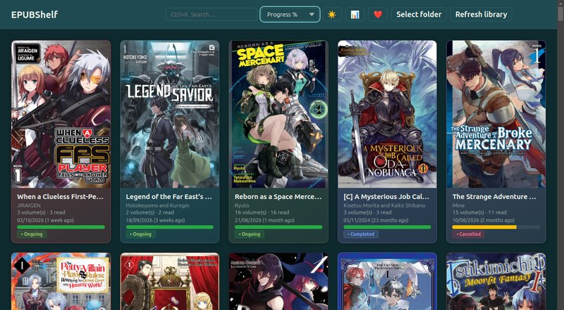
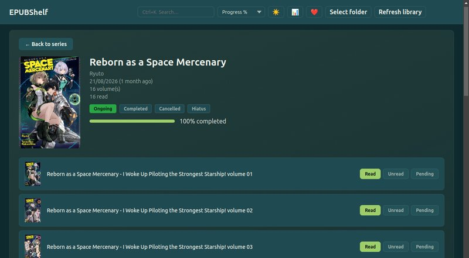

<p align="center">
  <picture>
    <source media="(prefers-color-scheme: dark)" srcset="https://raw.githubusercontent.com/ribaudequin/ribaudequin/main/assets/bandua-light.svg">
    
  </picture>
</p>

<h1 align="center">EPUBShelf</h1>

<p align="center">Organise your EPUB library by series.</p>

<p align="center"><sub>A <b>Bandua Studio</b> project · by Marcelo Salvador</sub></p>

---

A desktop application for managing your EPUB library, organized by series — with automatic metadata extraction, cover art, reading progress tracking, and intelligent search.

**v2.0.0** · [Download](https://github.com/ribaudequin/epub-library-manager/releases/tag/v2.0.0) · Linux (AppImage) · Windows (Installer + Portable) · macOS (Apple silicon)

---

## Features

- **📚 Recursive EPUB Scanner** — Index entire folder trees instantly with localStorage cache (scans that took 75s now run in <1s after first run)
- **🏷️ Metadata Extraction** — Title, author, series state (Ongoing/Acabada/Cancelada/Hiatus), and cover art pulled from inside each EPUB
- **🖼️ Series Grid** — Browse series as cards (100×140px covers) with dominant-tint coloring, reading progress bars, and skeleton shimmer loading
- **📖 Volume Detail View** — Per-series view with all volumes, states (lido / não lido / pendente), and bulk status actions
- **🔍 CTRL+K Search** — Fuzzy-match search across titles and authors with real-time result count
- **⬆️ Smart Sorting** — Sort by A→Z, Z→A, reading progress, or last-updated date (persisted in localStorage)
- **🌓 Dark & Light Themes** — Toggle between themes with persistent localStorage. WCAG-accessible with colored-tint backgrounds derived from cover art
- **📊 Statistics Dashboard** — Modal with library overview: total series/volumes, read count, progress %, state breakdown chart, largest series, and 30-day activity timeline (pure CSS/SVG)
- **♿ Accessibility First** — Focus-visible outlines, `prefers-reduced-motion`, ARIA live regions, keyboard navigation, WCAG-compliant tooltips and contrast ratios
- **💾 Persistent State** — Reading progress and series state saved in `userData` JSON
- **🔄 Automatic Backup** — Cover images cached and backed up automatically

---

## Screenshots

| Series Grid | Volume Detail |
|---|---|
| [](docs/assets/grid-view.png) | [](docs/assets/detail-view.png) |

Click a screenshot for the full-resolution version.

---

## Quick Start

### Prerequisites

- **Operating System**: Linux (AppImage or `.deb`), Windows (NSIS installer / portable) or macOS (Apple silicon)
- **Node.js**: 18+ (for building from source)
- **npm**: 9+

### Install & Run

#### Linux (AppImage)

Download `EPUBShelf-2.0.0.AppImage` from [GitHub Releases](https://github.com/ribaudequin/epub-library-manager/releases/tag/v2.0.0), then:

```bash
chmod +x EPUBShelf-2.0.0.AppImage
./EPUBShelf-2.0.0.AppImage
```

A Debian package is published alongside it: `epub-shelf_2.0.0_amd64.deb`.

#### Linux (Flatpak — build from source)

**EPUBShelf is not on Flathub.** The manifest builds and runs locally, but there is no published Flathub listing, so there is nothing to `flatpak install` from a remote.

To build it yourself:

```bash
git clone https://github.com/ribaudequin/epub-library-manager.git
cd epub-library-manager
flatpak-builder --user --install --force-clean build-dir io.github.ribaudequin.epub-library-manager.yml
flatpak run io.github.ribaudequin.epub-library-manager
```

See [`docs/FLATHUB-INSTALL.md`](docs/FLATHUB-INSTALL.md) for permissions and troubleshooting.

#### Windows

**Option A: Installer (recommended)**
Download `EPUBShelf-Setup-2.0.0.exe` from [GitHub Releases](https://github.com/ribaudequin/epub-library-manager/releases/tag/v2.0.0), double-click to install.

> **Windows SmartScreen note**: Since this app is unsigned, Windows may show a warning. Click **"More info"** → **"Run anyway"** to proceed. This is normal for unsigned open-source apps.

**Option B: Portable (no installation, no SmartScreen warning)**
Download `EPUBShelf-2.0.0.exe`, double-click to run directly. No installation required.

#### macOS

Download `EPUBShelf-2.0.0-arm64.dmg` from [GitHub Releases](https://github.com/ribaudequin/epub-library-manager/releases/tag/v2.0.0), open it and drag the app to Applications.

The published build is **Apple silicon (arm64)**. There is no Intel `.dmg`.

> **Gatekeeper note**: The build is unsigned, so macOS may refuse the first launch. Right-click the app and choose **Open**, then confirm — after that it launches normally.

### Build AppImage

```bash
npm run dist
```

The built AppImage appears in `dist/EPUBShelf-2.0.0.AppImage`.

### Build for Windows

```bash
npm run dist:win              # NSIS installer
npm run dist:win:portable     # Portable .exe (no SmartScreen)
```

### Build All Platforms

```bash
npm run dist:all              # AppImage + NSIS + portable
npm run dist:flatpak          # Flatpak dir build
```

### Features Highlights v2.0.0

- **🖼️ Volume Cover Preview** — Hovering or tabbing to a volume thumbnail floats the full-size cover above the list, so a 42×63 px thumbnail never has to stand in for the real artwork. Keeps each cover's own proportions, flips to the left near the right edge, and dismisses on `Esc`
- **🎨 Bandua Studio Branding** — Loading screen carries the Pixel Arc and a "Built by Bandua Studio" line; the About modal was rebuilt with the studio identity, X and LinkedIn profiles, Ko-fi and Patreon calls to action with copy-to-clipboard buttons, explorer links for the ETH and SOL addresses, and the MIT licence
- **🌍 Multi-language (PT/EN)** — Automatic system language detection via `app.getLocale()`. Translation engine inline in `translations.js` (no `fetch()` failures on `file://`)
- **🔄 Auto-refresh** — File watcher (`fs.watch` + 2s debounce) automatically rescans when you add/remove/edit EPUBs
- **📅 Localized Dates** — Relative dates adapt to locale (e.g., "21 months ago" / "há 21 meses")
- **🌓 Light Theme** — Toggle with persistent localStorage. Anti-flash script in `<head>`. Ghost-style toolbar buttons
- **📊 Statistics Dashboard** — 4 summary cards + state breakdown (CSS bars) + largest series + 30-day activity (SVG). All computed client-side
- **♿ WCAG AA** — All buttons pass 4.5:1 contrast. Modal with focus management and Escape to close

---

## Tech Stack

| Layer | Technology |
|---|---|
| **Runtime** | Electron 31 (Node.js + Chromium) |
| **Renderer** | Vanilla JavaScript |
| **UI** | HTML5, CSS Grid/Flex, CSS Custom Properties (themes) |
| **EPUB Parsing** | `adm-zip` (ZIP extraction), `@xmldom/xmldom` (XML metadata) |
| **Testing** | Playwright (Electron), Node test scripts |
| **Packaging** | electron-builder (AppImage, deb, NSIS, Portable, dmg) |
| **Flatpak** | Flatpak manifest — builds locally; not published on Flathub |

---

## Project Structure

```
biblioteca/
├── src/
│   ├── main.js          # Electron main: IPC, scanLibrary, filesystem
│   ├── preload.js       # Context bridge between main and renderer
│   ├── library.js       # EPUB scan logic, metadata extraction, cache
│   ├── renderer/
│   │   ├── index.html   # App shell
│   │   ├── renderer.js  # UI state, rendering, event handlers
│   │   └── styles.css   # Themes, grid layout, animations
├── test/
│   ├── validate-modules.js   # Module export validation
│   ├── test-cache.js          # Cache scan tests
│   ├── test-volume.js         # Volume metadata tests
│   └── generate-test-library.js
├── build/
│   └── icon.png          # App icon (256×256)
├── dist/                 # Built AppImages (gitignored artifacts)
├── docs/                 # Documentation assets (screenshots)
└── package.json
```

### Architecture Overview

- **`main.js`** — Electron main process: handles IPC, orchestrates library scans, manages filesystem operations
- **`renderer.js`** — Browser window UI: series grid, search, sorting, theme toggling, progress rendering
- **`preload.js`** — Secure context bridge exposing `window.api` for main↔renderer communication
- **`library.js`** — Pure library logic: EPUB ZIP parsing, XML metadata extraction, cache management (no Electron imports)

---

## Usage Guide

### Managing Your Library

1. **Point to your EPUB folder** — The app scans recursively for `.epub` files
2. **Series auto-detection** — Volumes are grouped automatically based on naming patterns
3. **Mark reading status** — Toggle individual volumes or use bulk actions in the series detail view
4. **Search & filter** — Press `Ctrl+K` and type to fuzzy-match titles or authors
5. **Sort** — Use the sort dropdown to reorder by name, progress, or last-updated date

### Keyboard Shortcuts

| Shortcut | Action |
|---|---|
| `Ctrl+K` | Focus search |
| `Esc` | Clear search |
| `Enter` / `Space` | Activate series card |

---

## Contributing

Contributions are welcome! Please follow these guidelines:

1. **Fork & clone** the repository
2. Create a feature branch: `git checkout -b feat/your-feature`
3. Make your changes and **run tests**: `npm test`
4. Commit with a clear message following [Conventional Commits](https://www.conventionalcommits.org/)
5. Push and open a Pull Request

### Development Workflow

```bash
npm install          # Install dependencies
npm start            # Launch app in development mode
npm test             # Run test suite (validate-modules.js)
npm run dist         # Build AppImage for Linux
npm run dist:win     # Build NSIS installer for Windows
npm run dist:all     # Build all platforms
```

> **Note**: Windows builds are cross-compiled from Linux using Wine. No code changes needed for cross-platform support.

---

## License

[MIT](./LICENSE) — see the [LICENSE](LICENSE) file for details.

---

## Support

EPUBShelf is free and open source. If it's useful to you, you can support the work:

<p>
  <a href="https://ko-fi.com/A0383T5"></a>
  <a href="https://www.patreon.com/banduastudio"></a>
</p>

**Cryptocurrency** — the ETH address accepts any EVM-compatible chain:

| Coin | Address | Explorer |
|---|---|---|
| ETH | `0x466f0c3ee495a3dc851fafa5c4720ab2fdcd4af4` | [Etherscan](https://etherscan.io/address/0x466f0c3ee495a3dc851fafa5c4720ab2fdcd4af4) |
| SOL | `Hnw5z47sk1hS6FsnCLfgX8pZhDryQVnZpzWJjSSRV5Nf` | [Solscan](https://solscan.io/account/Hnw5z47sk1hS6FsnCLfgX8pZhDryQVnZpzWJjSSRV5Nf) |

These addresses are also available in the app's **About** modal (click the ❤️ icon in the header).

## Elsewhere

<p>
  <a href="https://github.com/ribaudequin">GitHub</a> ·
  <a href="https://x.com/banduastudio">X</a> ·
  <a href="https://www.linkedin.com/in/bandua-marcelo-salvador">LinkedIn</a> ·
  <a href="https://ko-fi.com/A0383T5">Ko-fi</a> ·
  <a href="https://www.patreon.com/banduastudio">Patreon</a>
</p>
